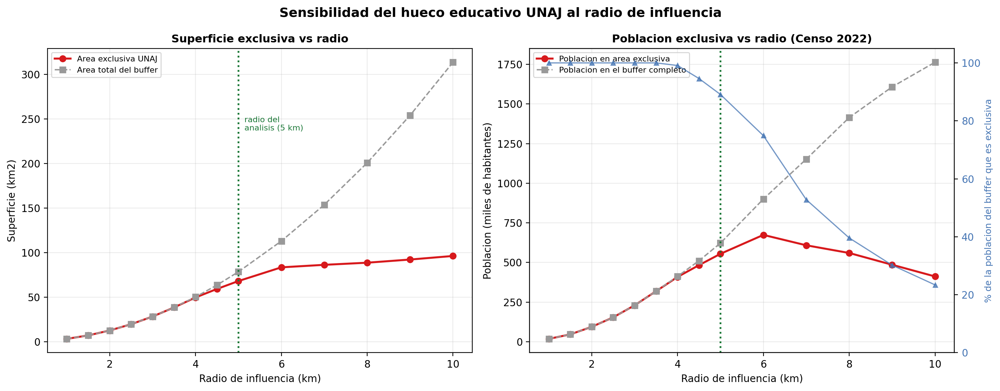
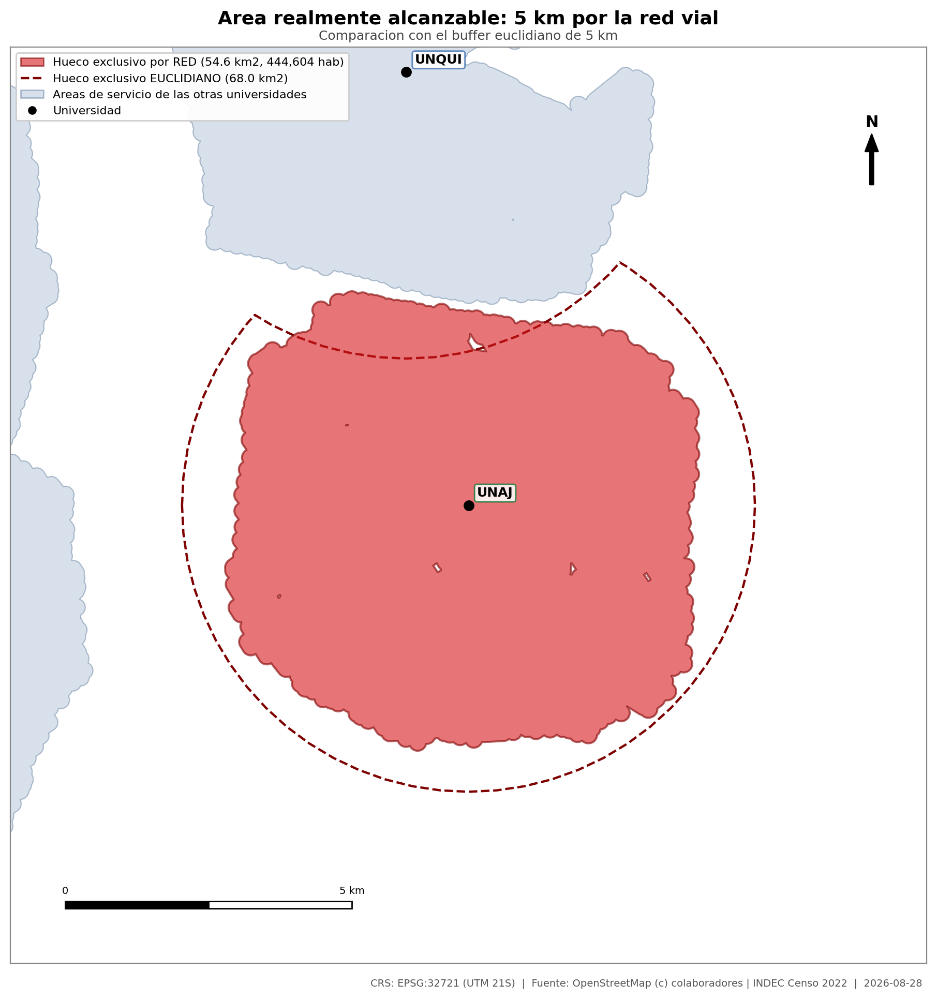
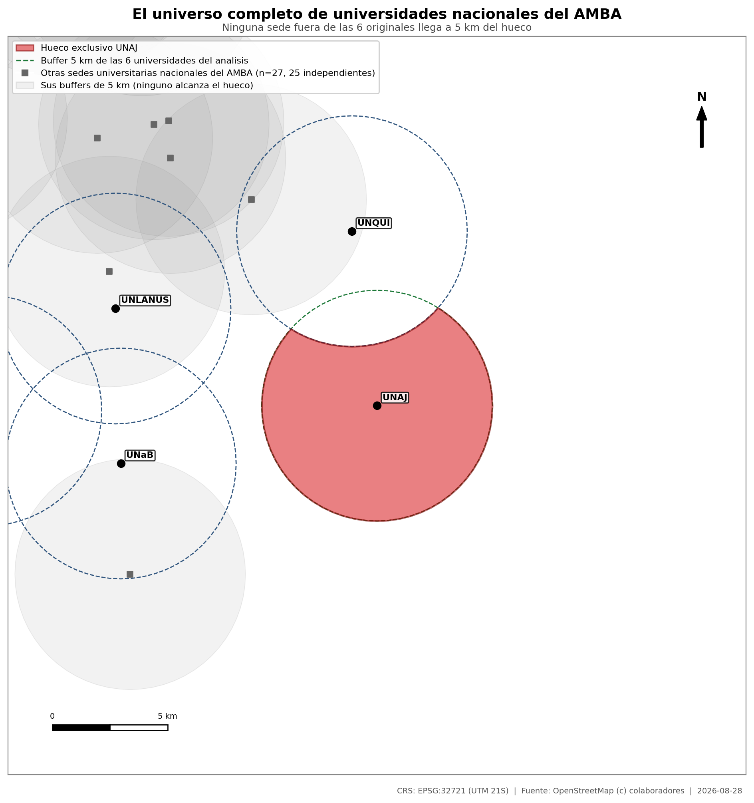
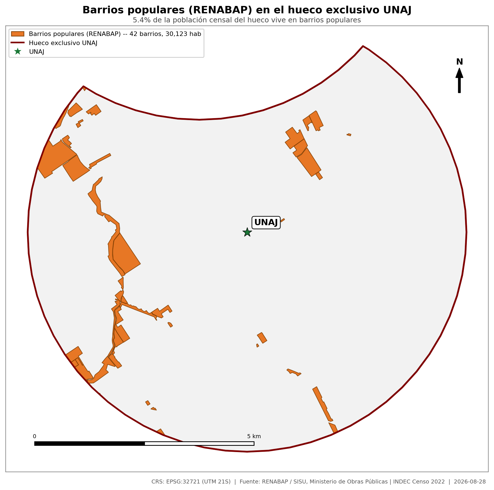
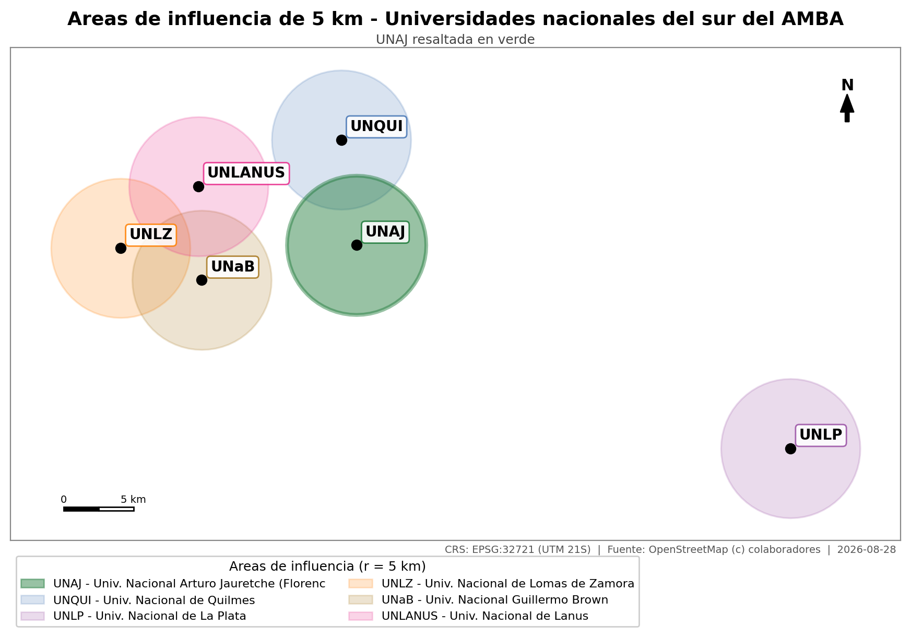
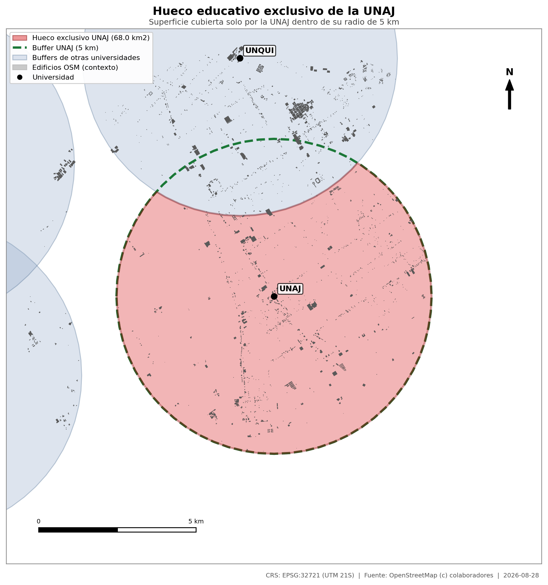
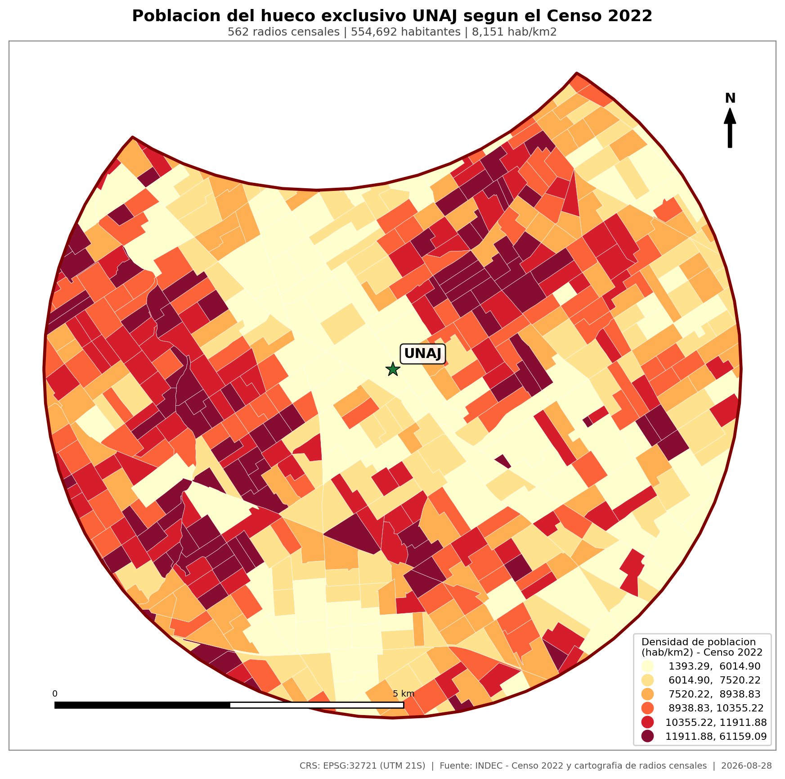
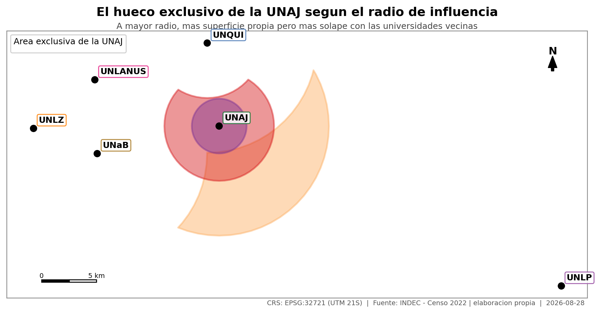
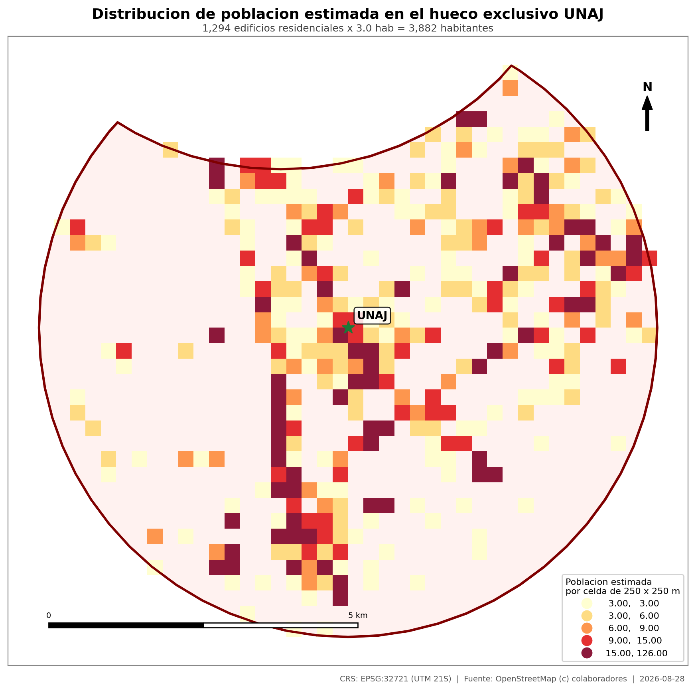

# Informe técnico — El Territorio de la UNAJ

**Proyecto:** Determinación del área de cobertura exclusiva de la Universidad Nacional Arturo Jauretche (UNAJ) en el sur del AMBA y de la población que vive en ella
**Fecha de elaboración:** 28/08/2026
**Sistema de referencia de trabajo:** EPSG:32721 — WGS 84 / UTM zona 21S (unidades: metros)
**Fuentes principales:** INDEC (Censo Nacional 2022 y cartografía de radios censales) · OpenStreetMap © colaboradores (ODbL)

---

## 1. Resumen ejecutivo

> **Hay 68,05 km² del sur del Conurbano donde la UNAJ es la única universidad nacional a menos de 5 km. Según el Censo 2022, allí viven 554.692 personas. La siguiente universidad nacional está a 7,88 km.**

Dentro de su radio de influencia de 5 km, la UNAJ cubre 68,05 km² —el **86,8 %** de esa área— que **ninguna** de las otras cinco universidades nacionales del sur del AMBA (UNQUI, UNLP, UNLZ, UNaB, UNLaNús) alcanza dentro del mismo radio.

El cruce de esa geometría con los **562 radios censales del Censo Nacional 2022** arroja **554.692 habitantes**, con una densidad de 8.151 hab/km². La zona abarca porciones de cuatro partidos: Quilmes, Florencio Varela, Berazategui y Almirante Brown. No es periferia: los 562 radios son de tipo **urbano** sin excepción.

Dos controles confirman que el resultado no depende de decisiones arbitrarias:

- **El radio de 5 km no es una elección oportunista** (§3.4). Repetido el análisis en 14 radios entre 1 y 10 km, hay población exclusiva en todos: hasta los 3,5 km la cobertura es 100 % exclusiva, y el máximo de población está en 6 km (674.001 hab). Los 5 km quedan del lado conservador.
- **Medido sobre la red vial real y no en línea recta** (§3.5), el área exclusiva es de 54,58 km² con 444.604 habitantes — y resulta **100 % exclusiva**: no solapa ni un metro cuadrado con el área de servicio de ninguna otra universidad nacional.
- **La comparación no se limita a 5 competidoras elegidas a mano** (§3.6). Puesta a prueba contra las 25 universidades nacionales del AMBA completo, ninguna alcanza el hueco: la más cercana queda a 5,88 km de su borde.
- **No es sólo una cuestión de distancia** (§3.7). Al menos 30.123 personas del hueco —el 5,4 %— viven en barrios populares relevados por el RENABAP, donde sólo el 12,9 % de las familias tiene conexión cloacal formal.
- **Se puso a prueba contra fuentes externas** (§8). Nuestra fuente censal subestima al INDEC oficial en los tres partidos (nunca lo exagera), y la composición del hueco coincide de cerca con la procedencia real de los estudiantes de la UNAJ en Florencio Varela y Berazategui — aunque diverge en Quilmes, la prueba más honesta de que el buffer de 5 km es una aproximación y no un mapa exacto.

| Indicador | Valor |
|---|---|
| Área del hueco exclusivo | **68,05 km²** |
| Porcentaje del radio de influencia de la UNAJ | 86,8 % |
| **Población (Censo 2022, interpolación areal)** | **554.692 habitantes** |
| Densidad de población | 8.151 hab/km² |
| Radios censales involucrados | 562 (todos urbanos) |
| Partidos alcanzados | Almirante Brown, Berazategui, Florencio Varela, Quilmes |
| Distancia a la universidad nacional más cercana | 7,88 km (UNQUI) |
| Distancia a la UNAJ | 0,25 km |

**Nota metodológica importante.** Una primera estimación con edificios de OpenStreetMap como proxy (§5) daba 3.882 habitantes. El cruce censal muestra que ese proxy **subestimaba la población por un factor de 143**, porque OSM tiene mapeado apenas el 2–4 % del parque construido de Florencio Varela. **La cifra válida es la censal.** El proxy se conserva documentado en este informe únicamente como registro de por qué fue descartado.

---

## 2. Metodología

### 2.1 Fuentes

| Elemento | Detalle |
|---|---|
| Ubicación de universidades | 6 puntos en WGS84 provistos por el solicitante |
| Geometría de radios censales 2022 | INDEC — GeoNode institucional, capa `geonode:radios_censales2` (WFS oficial) |
| Población por radio 2022 | Boccolini, S. M. (2026), *Argentina (2022) radios censales con datos de cantidad de población y densidad de población*, CONICET Digital, CC BY 2.5 AR — tabulación del Censo 2022 de INDEC (Redatam) |
| Edificios (proxy descartado) | OpenStreetMap, tag `building=*`, vía Overpass API — descarga del 2026-08-28 |
| CRS de análisis | **EPSG:32721 (UTM 21S)** — proyectado, métrico |

### 2.2 Cadena de procesamiento

1. **Área de estudio.** Unión de los seis buffers de 5 km (415 km²), reproyectada a WGS84 para consultar las fuentes.
2. **Reproyección.** Todas las capas se llevan a EPSG:32721. Cada función de medición valida antes que el CRS sea proyectado (`verificar_crs_proyectado()`) y aborta si no lo es.
3. **Buffers.** Buffer de 5.000 m por universidad (78,41 km² cada uno; π·r² = 78,54 km², la diferencia es la discretización del círculo).
4. **Resta topológica.** `hueco = buffer_UNAJ − unión(buffers de las otras cinco)`. Es una **diferencia**, no una diferencia simétrica: interesa lo que cubre la UNAJ *y nadie más*.
5. **Cruce censal (resultado principal).** Los radios censales 2022 se intersecan con el hueco y se aplica **interpolación areal**: a cada radio se le asigna la fracción de su población proporcional a la fracción de su superficie que cae dentro del hueco. De los 562 radios, **453 quedan íntegramente dentro** y sólo los del borde se ponderan.
6. **Distancias.** Desde el punto representativo del hueco a cada universidad.
7. **Sensibilidad al radio.** Se repiten los pasos 3 a 5 para 14 radios entre 1 y 10 km.
8. **Áreas de servicio sobre red.** Se construye un grafo no dirigido con la red vial de OSM (excluidas autopistas y vías rápidas, no transitables a pie) y se calculan por Dijkstra los nodos alcanzables con un recorrido de 5.000 m; el área de servicio es la unión de las aristas alcanzables con un buffer de acceso de 150 m desde el eje de calle.
9. **Universo de competidoras.** Se descargan todas las sedes `amenity=university` de OSM en el AMBA completo, se filtran por gestión nacional y se excluyen las 6 ya incluidas por proximidad espacial (≤ 500 m); se mide la distancia de cada una al hueco.
10. **Barrios populares.** Los polígonos del RENABAP se intersecan con el hueco por el mismo método de interpolación areal que los radios censales; las familias se convierten a personas con el mismo factor de ocupación del hogar.
11. **Auditoría independiente.** `scripts/gis_auditor.py` relee los productos desde disco y **recalcula** la resta topológica, la cobertura censal y la suma poblacional ponderada, sin confiar en los metadatos.

*Nota de implementación:* la descarga de OSM se resolvió con un cliente Overpass propio (`requests` + POST con `User-Agent` explícito). Durante la ejecución `osmnx` falló de forma sistemática contra ese endpoint desde la red utilizada (timeouts de conexión reiterados) y los mirrors públicos (`kumi.systems`, `private.coffee`, `osm.jp`) devolvieron 500/502. La consulta POST directa respondió de forma estable en 2–7 s por celda.

### 2.3 Decisión sobre el CRS

Se utilizó **EPSG:32721 (UTM 21S)**, no el WGS84 geográfico ni Gauss-Krüger:
- El AMBA cae en la zona UTM 21S, con distorsión de escala inferior al 0,1 % en la extensión analizada.
- Buffers, áreas y distancias **exigen** un CRS métrico proyectado: en grados los círculos salen elípticos y las áreas no tienen sentido físico.

---

## 3. Resultados

### 3.1 Geometría del hueco

| Métrica | Valor |
|---|---|
| Área del buffer UNAJ (5 km) | 78,41 km² |
| Área de la unión de las 5 competidoras | 346,85 km² |
| **Área del hueco exclusivo UNAJ** | **68,05 km²** |
| Proporción del buffer UNAJ | 86,8 % |
| Tipo de geometría | Polygon (1 parte/s) |

Que el hueco represente el 86,8 % del buffer es en sí un resultado: la UNAJ prácticamente no comparte su área de influencia con nadie. Sólo el borde norte se solapa con la UNQUI.

### 3.2 Población según el Censo 2022

| Métrica | Valor |
|---|---|
| Radios censales que intersecan el hueco | 562 |
| Radios íntegramente dentro del hueco | 453 |
| Radios de tipo urbano | 562 (100 %) |
| Cobertura censal del hueco | 68,05 km² de 68,05 km² (completa) |
| **Población — interpolación areal** | **554.692 habitantes** |
| Población — criterio de centroide (control) | 548.336 habitantes |
| Diferencia entre ambos métodos | 1,1 % |
| **Densidad de población** | **8.151 hab/km²** |

Los dos criterios de asignación —ponderar por área y asignar el radio entero según dónde caiga su centroide— arrojan cifras que difieren en 1,1 %. Esa coincidencia es el mejor indicador de que el resultado no depende de la decisión metodológica.

**Desglose por partido**

| Partido | Radios | Área en el hueco (km²) | Población | Densidad (hab/km²) |
|---|---|---|---|---|
| Quilmes | 223 | 25,24 | 222.547 | 8.818 |
| Florencio Varela | 192 | 23,94 | 187.526 | 7.832 |
| Berazategui | 136 | 17,95 | 135.500 | 7.550 |
| Almirante Brown | 11 | 0,92 | 9.119 | 9.905 |

El hueco es, en rigor, un área **intermunicipal**: la UNAJ presta cobertura de proximidad no sólo a Florencio Varela sino al sur de Quilmes y al oeste de Berazategui, que suman juntos el 65 % de la población de la zona.

### 3.3 Distancias desde el centro del hueco

| Universidad | Denominación | Distancia al centroide del hueco (km) | Distancia mínima al polígono (km) |
|---|---|---|---|
| UNAJ | Universidad Nacional Arturo Jauretche (Florencio Varela) | 0,25 | 0,00 |
| UNQUI | Universidad Nacional de Quilmes (Bernal) | 7,88 | 4,99 |
| UNaB | Universidad Nacional Guillermo Brown (Burzaco) | 11,34 | 6,39 |
| UNLANUS | Universidad Nacional de Lanus (Remedios de Escalada) | 12,18 | 7,10 |
| UNLZ | Universidad Nacional de Lomas de Zamora | 16,94 | 11,94 |
| UNLP | Universidad Nacional de La Plata | 34,31 | 29,42 |

La lectura es directa: para quien vive en el centro de esta zona, la UNAJ está a **0,25 km** y la siguiente universidad nacional a **7,88 km**. Las restantes superan los 11 km.

### 3.4 Sensibilidad al radio de influencia

Los 5 km son un parámetro elegido, no un dato. Para que el resultado no dependa de esa elección se repitió el análisis completo —resta topológica y población censal— en 14 radios entre 1 y 10 km.

| Radio (km) | Área exclusiva (km²) | % del buffer | Población exclusiva | % de la población del buffer |
|---|---|---|---|---|
| 1,0 | 3,14 | 100,0 | 17.904 | 100,0 |
| 1,5 | 7,06 | 100,0 | 46.314 | 100,0 |
| 2,0 | 12,55 | 100,0 | 93.809 | 100,0 |
| 2,5 | 19,60 | 100,0 | 153.725 | 100,0 |
| 3,0 | 28,23 | 100,0 | 229.713 | 100,0 |
| 3,5 | 38,42 | 100,0 | 318.839 | 100,0 |
| 4,0 | 49,63 | 98,9 | 408.862 | 99,1 |
| 4,5 | 59,16 | 93,2 | 483.125 | 94,6 |
| 5,0 | 68,05 | 86,8 | 554.692 | 89,1 |
| 6,0 | 83,44 | 73,9 | 674.001 | 74,9 |
| 7,0 | 86,25 | 56,1 | 608.389 | 52,8 |
| 8,0 | 88,64 | 44,2 | 559.894 | 39,6 |
| 9,0 | 92,19 | 36,3 | 485.599 | 30,2 |
| 10,0 | 96,20 | 30,7 | 411.833 | 23,4 |

Tres lecturas:

1. **Hasta los 3,5 km la cobertura de la UNAJ es 100 % exclusiva.** Ninguna otra universidad nacional llega siquiera a rozar su área de influencia. Ya en un radio de 3 km —unos 35 minutos a pie— hay 229.713 personas para las que la UNAJ es la única opción.
2. **La población exclusiva alcanza su máximo en 6 km con 674.001 habitantes.** El primer solape aparece a los 4 km, contra la UNQUI, pero hasta los 6 km lo que se gana ampliando el radio supera lo que se pierde por competencia; a partir de ahí se invierte. El radio de 5 km del análisis está *antes* del máximo: es una elección **conservadora**, no favorable.
3. **La conclusión no depende del radio.** En todo el rango de 3 a 10 km hay entre 229.713 y 674.001 habitantes exclusivos. Incluso en el escenario más desfavorable (10 km, donde media región queda a tiro de varias universidades) siguen quedando 411.833 personas que sólo tienen a la UNAJ cerca.

### 3.5 Accesibilidad real: áreas de servicio sobre la red vial

El buffer euclidiano supone que se puede ir en línea recta en cualquier dirección. En el sur del Conurbano eso es falso: están el ferrocarril Roca, la Autopista Buenos Aires–La Plata, arroyos y trazados irregulares. Para medir el área **realmente alcanzable** se construyó un grafo enrutable con la red vial de OpenStreetMap (186.682 nodos, 243.298 aristas) y se calcularon las áreas de servicio recorriendo 5.000 m de calle desde cada universidad.

| Universidad | Área por red (km²) | Círculo de 5 km (km²) | Cobertura real |
|---|---|---|---|
| UNAJ | 54,58 | 78,41 | 69,6 |
| UNQUI | 41,17 | 78,41 | 52,5 |
| UNLP | 49,23 | 78,41 | 62,8 |
| UNLZ | 48,21 | 78,41 | 61,5 |
| UNaB | 62,08 | 78,41 | 79,2 |
| UNLANUS | 59,80 | 78,41 | 76,3 |

**El círculo euclidiano sobreestima la cobertura de todas las universidades**, entre un 21 % y un 48 %. El caso extremo es la UNQUI: sólo el 52,5 % de su círculo es alcanzable con 5 km de recorrido, porque el Río de la Plata se lleva buena parte del área nominal.

Rehecha la resta topológica sobre las áreas de servicio:

| Métrica | Buffer euclidiano | Red vial | Ratio |
|---|---|---|---|
| Área exclusiva | 68,05 km² | **54,58 km²** | 80,2 % |
| Población (Censo 2022) | 554.692 | **444.604** | 80,2 % |
| Densidad | 8.151 hab/km² | 8.146 hab/km² | — |

Y aquí aparece el hallazgo más contundente del informe: **por red vial, el área de servicio de la UNAJ es 100 % exclusiva**. No solapa ni un metro cuadrado con la de ninguna otra universidad nacional. La más cercana —la UNQUI— queda a 90 m de distancia sin llegar a tocarla; las demás, entre 2,4 y 25 km.

Ese resultado es robusto al supuesto de acceso: repitiendo el cálculo con distancias de acceso desde el eje de calle de 200, 250 y 300 m (en vez de los 150 m adoptados), la exclusividad se mantiene en 100 %, 99,9 % y 99,5 %.

**Cómo leerlo.** El área exclusiva por red es menor (54,58 km² contra 68,05 km²) porque la distancia por calle siempre es mayor que la distancia en línea recta. Pero la conclusión se refuerza: dentro de lo que la gente puede efectivamente recorrer, **la UNAJ no compite con nadie**. Los 444.604 habitantes de esa área son la cifra metodológicamente más defendible del informe.

---

### 3.6 ¿Es realmente la única? El universo completo de universidades nacionales

Todo lo anterior compara la UNAJ contra 5 competidoras elegidas a mano. Antes de sostener "única universidad nacional de proximidad" en la conclusión, esa elección se puso a prueba: se descargaron de OpenStreetMap **las 763 sedes** tageadas como universidad en todo el AMBA —no sólo el sur—, se filtraron por patrones de gestión nacional (Universidad Nacional *, UTN, Universidad de Buenos Aires) excluyendo explícitamente instituciones privadas (ITBA) y de gestión no nacional (Universidad de la Ciudad de Buenos Aires), y se excluyeron por proximidad espacial las 6 ya contempladas.

Quedaron **27 candidatas** fuera de las 6 originales. De ellas, 2 resultaron ser sedes secundarias de universidades **ya incluidas** (un campus adicional de la UNaB y un predio de la UNLaNús, tageados en OSM lejos del punto oficial usado) — quedan **25 instituciones genuinamente independientes**: UNDAV, UTN con sus varias facultades regionales, UBA, Universidad Nacional de Tres de Febrero, La Matanza, Lomas... hasta Pilar.

| Institución más cercana | ¿Es una universidad nueva? | Distancia al borde del hueco |
|---|---|---|
| Universidad Tecnológica Nacional - Facultad Regional Avellaneda | — | 5,88 |
| Campus Universidad Nacional de Almirante Brown | UNaB (sede secundaria, Campus Almirante Brown) | 7,96 |
| Predio Yrigoyen Universidad Nacional de Lanús | UNLaNUS (sede secundaria, Predio Yrigoyen) | 7,99 |
| Universidad de Buenos Aires - Centro Universitario Regional Sur | — | 9,08 |
| UTN Facultad Regional Avellaneda | — | 10,47 |
| Universidad Nacional de Avellaneda | — | 10,69 |
| Universidad Nacional de Avellaneda | — | 11,80 |
| Universidad Nacional de Tres de Febrero | — | 16,44 |
| Universidad Tecnológica Nacional - FRBA - Campus | — | 17,26 |
| Universidad de Buenos Aires | — | 18,39 |

**Ninguna alcanza el hueco.** La más cercana —una sede de la UTN en Avellaneda— queda a **5,88 km** de su borde: fuera de su propio radio de 5 km por apenas 900 metros. El resto está a 8 km o más. El universo ampliado **no cambia un metro cuadrado** del resultado.

**Una precisión necesaria sobre el alcance de la afirmación.** "Única universidad nacional de proximidad" es correcto tal como está formulado, pero es una afirmación específicamente sobre universidades de gestión **nacional**. La zona sí cuenta con oferta pública de nivel superior **no universitario**, de gestión **provincial**: se identificaron al menos estos institutos operando en el área, según la Dirección General de Cultura y Educación de la Provincia de Buenos Aires:

| Instituto | Partido |
|---|---|
| ISFD N° 50 | Berazategui/Quilmes/Fcio. Varela |
| ISFD N° 54 | Florencio Varela |
| ISFD N° 104 | Quilmes |
| ISFDyT N° 24 "Dr. B. A. Houssay" | Quilmes (Bernal) |
| ISFDyT N° 83 | Quilmes |

Estos institutos ofrecen profesorados y tecnicaturas, no las carreras de grado (ingenierías, licenciaturas) que ofrece una universidad. La afirmación del informe se sostiene sin matices para "universidad nacional"; sería incorrecto extenderla a "toda oferta de educación superior". Este relevamiento de institutos es manual y no exhaustivo —la misma incompletitud de OSM que afectó al proxy de edificios (§5) impide geolocalizarlos con precisión—, a diferencia del universo de universidades nacionales, que sí es sistemático y verificable.

### 3.7 Equidad: población en barrios populares (RENABAP)

El área y la población del hueco no dicen nada sobre quién vive ahí. Para eso se cruzó el hueco con el **Registro Nacional de Barrios Populares** (RENABAP) del Ministerio de Obras Públicas, que releva casa por casa los asentamientos informales del país.

| Métrica | Valor |
|---|---|
| Barrios populares en el hueco | 42 (30 íntegros) |
| Familias relevadas | 10.041 |
| Población estimada en barrios populares | **30.123 habitantes** |
| Proporción de la población censal del hueco | **5,4 %** |
| Partidos | Berazategui, Florencio Varela, Quilmes |

Más de **1 de cada 20 habitantes** del hueco exclusivo de la UNAJ vive en un asentamiento informal registrado por el Estado. El dato de infraestructura es más duro que el de población: el RENABAP no pregunta "¿tenés agua?" sino *cómo* está conectada cada familia, y ahí aparece la carencia real:

| Servicio | Barrios con conexión formal | Familias con conexión formal |
|---|---|---|
| Electricidad | 16,7 % | **5,9 %** |
| Agua corriente | 14,3 % | **15,2 %** |
| Cloaca | 2,4 % | **12,9 %** |

La brecha más severa de las tres es la eléctrica: sólo el **5,9 % de las familias** tiene una conexión formal con medidor domiciliario; el resto se conecta de forma irregular a la red. En cloaca, el **12,9 %** tiene conexión formal y el resto desagua a pozo negro o cámara séptica. Son carencias que afectan a miles de las 10.041 familias relevadas.

Los asentamientos se concentran de forma marcada sobre el curso de un arroyo al oeste del hueco — el patrón espacial típico de la urbanización informal argentina, que ocupa terrenos no aptos (bajos inundables, márgenes de arroyos) porque son los únicos disponibles.

**Lectura para la conclusión.** No es sólo que la UNAJ sea la única universidad de proximidad para 554.692 personas: para al menos 30.123 de ellas, además, es la única universidad de proximidad **sin** que tengan una conexión eléctrica formal en su casa. Es el argumento de equidad que el análisis puramente geométrico no puede dar por sí solo.

---

## 4. Cartografía

### Mapa 1 — Áreas de influencia comparadas (r = 5 km)

Los seis círculos de 5 km. La UNAJ (verde) está en el extremo sudeste del sistema: sus vecinas se concentran al oeste y al norte, y La Plata queda muy al sudeste, dejando descubierto el corredor de Florencio Varela.

### Mapa 2 — Hueco exclusivo de la UNAJ

En rojo, la superficie que sólo la UNAJ cubre dentro de 5 km, sobre el fondo de edificios de OSM.

### Mapa 3 — Población según el Censo 2022 (mapa principal)

Densidad de población por radio censal dentro del hueco. Los 562 radios teselan el polígono por completo. Se distinguen con claridad los núcleos densos de Quilmes sur y del casco de Florencio Varela frente a los corredores de menor densidad.

### Mapa 4 — Barrios populares (RENABAP)

Los 42 asentamientos informales relevados dentro del hueco.

### Mapa 5 — El universo completo de universidades

Las 25 universidades nacionales del AMBA fuera de las 6 originales, con sus buffers de 5 km. Ninguna toca el hueco.

### Mapa 6 — Sensibilidad al radio

El hueco exclusivo para radios de 2,5, 5, 7,5 y 10 km.

### Mapa 7 — Edificios OSM (proxy descartado)

Se conserva como registro del método descartado. Comparado con el Mapa 3 muestra visualmente el problema: los edificios mapeados en OSM son un subconjunto disperso del tejido real.

---

## 5. El proxy de edificios OSM y por qué fue descartado

La primera estimación siguió el método del proxy de edificios: contar edificios de OSM dentro del hueco y multiplicar por un factor de ocupación.

| Métrica | Valor |
|---|---|
| Edificios OSM descargados en el área de estudio | 10.327 |
| Edificios cuyo centroide cae en el hueco | 1.497 |
| Edificios clasificados como residenciales | 1.294 |
| Criterio de clasificación | `todos_menos_no_residenciales` |
| Factor de ocupación aplicado | 3 hab/edificio |
| Población estimada | 3.882 habitantes |
| Densidad resultante | 57 hab/km² |

**El factor de ocupación no era el problema.** Se aplicaron 3 habitantes por edificio residencial, valor consistente con el tamaño medio del hogar en la provincia de Buenos Aires y con el supuesto de un hogar por edificio, razonable en tejido de vivienda unifamiliar. Aun un factor de 4 sólo habría movido la cifra a ~5.200.

**El problema era la completitud de OpenStreetMap.** Los 1.497 edificios mapeados en 68,05 km² dan 22 edif/km², cuando un tejido urbano consolidado tiene entre 600 y 1.200. Argentina no recibió una importación masiva de huellas de edificios, y el mapeo colaborativo en el Conurbano sur es fragmentario. El resultado: el proxy captura **entre el 2 % y el 4 %** del parque construido y subestima la población por un factor de **143**.

Sólo el 20,9 % de los edificios del hueco tenía un tag residencial explícito (predomina `building=yes`), por lo que se usaron todos los edificios excepto los tageados explícitamente como no residenciales — una decisión que amplía la selección y aun así queda dos órdenes de magnitud corta.

Antes de disponer del dato censal se hizo un contraste de plausibilidad (`scripts/calibracion_poblacion.py`) que, suponiendo densidades de 2.000–7.000 hab/km², acotaba la población entre 136.000 y 476.000. El censo dio 554.692: **incluso ese contraste se quedó corto**, porque la densidad real del hueco (8.151 hab/km²) supera el extremo superior del rango supuesto. Se deja registrado como recordatorio de que un contraste basado en supuestos acota el orden de magnitud pero no sustituye la medición.

**Conclusión metodológica:** el proxy de edificios OSM es inutilizable para estimar población en esta región. Donde exista cartografía censal, ésa es la fuente; el proxy sólo tiene sentido en áreas sin censo reciente y con OSM bien cubierto.

---

## 6. Advertencias y limitaciones

**6.1 Interpolación areal.** El método asume que la población se distribuye uniformemente dentro de cada radio censal. Es un supuesto estándar y su impacto acá es acotado: 453 de los 562 radios (81 %) quedan íntegramente dentro del hueco, y sólo los del borde se ponderan. El control por centroide difiere en 1,1 %.

**6.2 Fuente de la tabla poblacional.** La geometría de los radios es oficial de INDEC. La población por radio proviene de una tabulación del Censo 2022 publicada por CONICET bajo CC BY 2.5, no de una descarga directa de Redatam. Se validó comparando los totales por partido con las cifras del Censo 2022: Florencio Varela 485.105, Quilmes 631.551, Berazategui 355.277 — coincidentes. El archivo está filtrado a radios con densidad > 1 hab/ha; en el hueco **ningún** radio quedó sin dato, de modo que el filtro no introduce faltantes aquí.

**6.3 Accesibilidad: resuelto en parte.** La objeción al buffer euclidiano se atendió en §3.5 con áreas de servicio sobre la red vial, y el resultado confirmó que el círculo sobreestima la cobertura entre un 21 % y un 48 %. Lo que **sigue sin modelarse** es el tiempo de viaje real: el grafo mide distancia recorrida, no minutos, y no incorpora frecuencia ni recorridos del transporte público (haría falta GTFS). Tampoco se aplican sentidos únicos, decisión deliberada porque el análisis representa acceso peatonal y en colectivo, no en automóvil particular.

**6.3.bis Supuesto de acceso desde el eje de calle.** Las áreas de servicio se construyen buffereando las calles alcanzables 150 m, media manzana típica del Conurbano. Se verificó que la conclusión de exclusividad total aguanta con 200, 250 y 300 m.

**6.4 Un punto por universidad.** Cada universidad se representa con una sola sede. Varias (notablemente UNLP y UNLZ) tienen facultades dispersas; considerar todas las sedes podría reducir el hueco.

**6.5 Universidades no incluidas.** El análisis se restringe a las seis universidades nacionales indicadas. No contempla universidades privadas, institutos de formación docente ni sedes de la UTN.

**6.6 Población total, no población objetivo.** Los 554.692 habitantes son la población total residente, no la demanda potencial de educación superior. Acotar la franja etaria relevante (18–29 años) y el nivel educativo alcanzado requiere tabulaciones censales adicionales por radio.

---

## 7. Conclusiones

**La hipótesis se verifica, y con un dato censal sólido detrás.**

1. **El área existe y es grande.** 68,05 km² —el 86,8 % del radio de influencia de la UNAJ— quedan fuera del alcance de 5 km de todas las demás universidades nacionales del sur del AMBA.
2. **Está densamente poblada.** 554.692 habitantes según el Censo 2022, a 8.151 hab/km². Los 562 radios censales son todos urbanos. Es el orden de magnitud de una ciudad como Santa Fe o Corrientes.
3. **El alcance es intermunicipal.** No es sólo Florencio Varela: Quilmes aporta 222.547 habitantes y Berazategui 135.500. La UNAJ cubre un área que sus partidos vecinos no tienen resuelta con sus propias instituciones.
4. **El resultado es robusto.** No depende del radio elegido (hay población exclusiva en todo el rango de 1 a 10 km) ni del supuesto de distancia en línea recta: medido sobre la red vial, el área de servicio de la UNAJ es **100 % exclusiva**, con 444.604 habitantes. Tampoco depende de la lista de competidoras: contra el universo completo de 25 universidades nacionales del AMBA, ninguna reduce el hueco.
5. **Hay una dimensión de equidad que el área y la población no capturan.** 30.123 personas del hueco viven en barrios populares con infraestructura precaria (12,9 % de conexión cloacal formal). Para ellas, la proximidad de la UNAJ no es una comodidad: es, probablemente, la diferencia entre tener o no tener acceso a la universidad pública.
6. **El aislamiento es real, no marginal.** La universidad nacional más próxima al centro del hueco está a 7,88 km, contra 0,25 km de la UNAJ. Para esta población la UNAJ no es *una* opción: es **la** opción de proximidad.
7. **Implicancia de política pública.** El cierre o desfinanciamiento de la UNAJ no redistribuiría su matrícula entre instituciones vecinas: dejaría a más de medio millón de personas sin cobertura universitaria pública dentro de un radio razonable de desplazamiento cotidiano.
8. **Lección metodológica.** El proxy de edificios OSM habría hecho parecer que en esta zona viven menos de 4.000 personas. El cruce con la cartografía censal corrigió el resultado en un factor de 143. En análisis de accesibilidad a servicios públicos, la fuente poblacional importa más que la sofisticación del método geométrico.
9. **El resultado se sostiene contra fuentes externas independientes** (§8): nuestra propia fuente censal subestima la población oficial del INDEC en todos los partidos, nunca la exagera, y la composición del hueco coincide de cerca con la procedencia real de los estudiantes de la UNAJ en los dos partidos donde el ajuste es mejor.

---

## 8. Validación externa

Todo lo anterior se construyó con las fuentes que declaramos en cada sección. Antes de darlo por cerrado, se puso a prueba contra tres referencias externas que no forman parte del pipeline: los totales oficiales del Censo 2022, la vigencia del RENABAP, y —la más exigente— la procedencia real de los estudiantes de la UNAJ.

### 8.1 ¿La fuente censal exagera? No: subestima.

La tabla de CONICET/Boccolini que usamos en §3.2 es una tabulación derivada del Censo 2022, no la fuente oficial en sí. Se comparó su población total por partido contra los **resultados definitivos** publicados por INDEC:

| Partido | Nuestra fuente | INDEC oficial (definitivo) | Diferencia |
|---|---|---|---|
| Florencio Varela | 485.105 | 496.433 | -2,28 % |
| Quilmes | 631.551 | 633.191 | -0,26 % |
| Berazategui | 355.277 | 358.712 | -0,96 % |

En los tres partidos la diferencia es negativa: **nuestra fuente da menos población que la oficial, nunca más**. La causa más probable es el filtro de origen del dataset (densidad > 1 hab/ha), que excluye radios de baja densidad — hay más de ese tipo de radio en Florencio Varela que en Quilmes, lo que explica por qué la brecha es mayor ahí (2,28 %) que en Quilmes (0,26 %). **Los 554.692 habitantes del hueco son, si acaso, una cota conservadora.**

### 8.2 El RENABAP que usamos ya quedó chico

La capa de barrios populares (§3.7) es el relevamiento **2020** del RENABAP. El registro nacional creció desde entonces:

| | 2020 (lo que usamos) | Actual |
|---|---|---|
| Barrios populares relevados (país) | 4.416 | **6.467** |

Un crecimiento del **+46,4 %**. Por la misma lógica que en §8.1, los 42 barrios y 30.123 habitantes que contamos en el hueco son también, casi con certeza, una subestimación de la situación actual.

### 8.3 La prueba más dura: ¿coincide con la matrícula real?

Las dos validaciones anteriores comparan una fuente de población contra otra. Esta es distinta: compara la **predicción geométrica** del buffer de 5 km contra **comportamiento real** — de dónde vienen efectivamente los estudiantes que hoy cursan en la UNAJ, según datos que publica la propia universidad.

| Partido | % real de matrícula UNAJ | % de población en el hueco | Diferencia |
|---|---|---|---|
| Florencio Varela | 33,0 % | 33,8 % | +0,8 pp |
| Berazategui | 22,0 % | 24,4 % | +2,4 pp |
| Almirante Brown | 8,0 % | 1,6 % | -6,4 pp |
| Quilmes | 22,0 % | 40,1 % | +18,1 pp |

**Florencio Varela calza casi exacto.** Quilmes es donde más diverge. La lectura honesta: el buffer de 5 km captura bien la demanda de los partidos donde la UNAJ no compite con nadie más (Florencio Varela, Berazategui), pero es una aproximación más floja donde sí hay competencia real por otras universidades (Quilmes) o donde la gente cruza el buffer en la dirección contraria a la esperada (Almirante Brown, que manda más estudiantes de los que el hueco geométrico sugeriría). **El radio de 5 km es una aproximación razonable del área de influencia, no un mapa exacto de la demanda.**

### 8.4 Metodología: respaldo en la literatura

El uso de buffers y áreas de influencia para medir accesibilidad a servicios públicos es práctica estándar en la geografía argentina — la misma lógica que estudios de accesibilidad a centros de salud (línea de trabajo de G. Buzai, Universidad Nacional de Luján). La progresión que seguimos en este proyecto, de buffer euclidiano (§3.1) a isócronas por red vial (§3.5), es exactamente la evolución metodológica que esa literatura recomienda cuando hay barreras geográficas de por medio.

---

## 9. Auditoría

Veredicto del agente independiente `gis-auditor`: **APROBADO** (INFO: 51, WARNING: 4, ERROR: 0, CRITICAL: 0).

El auditor no reutiliza los resultados guardados: relee cada capa desde disco y recalcula la resta topológica, la cobertura de los radios sobre el hueco y la suma poblacional ponderada.

**Verificaciones superadas (INFO)**

- **crs_correcto** — buffers: CRS EPSG:32721 (proyectado, metros)
- **crs_correcto** — hueco_exclusivo: CRS EPSG:32721 (proyectado, metros)
- **crs_correcto** — edificios_en_hueco: CRS EPSG:32721 (proyectado, metros)
- **crs_correcto** — edificios_utm: CRS EPSG:32721 (proyectado, metros)
- **crs_correcto** — universidades: CRS EPSG:32721 (proyectado, metros)
- **n_buffers** — 6 buffers presentes
- **area_buffer** — Areas de buffer coherentes con pi*r^2 = 78.54 km2 (discretizacion del circulo < 1%)
- **area_hueco_positiva** — Area del hueco = 68.05 km2 (> 0)
- **hueco_menor_que_buffer** — El hueco (68.05 km2) representa 86.8% del buffer UNAJ (78.41 km2)
- **validez_hueco** — Geometria del hueco valida (Polygon)
- **recalculo_resta** — Resta topologica reproducida de forma independiente: 68.0479 km2
- **hueco_sin_solape** — El hueco no solapa con ningun buffer competidor
- **hueco_dentro_unaj** — El hueco esta contenido dentro del buffer de la UNAJ
- **edificios_en_hueco** — 1,294 edificios seleccionados dentro del hueco sobre 10,327 descargados (12.5%)
- **edificios_dentro_del_hueco** — Los 1,294 edificios verificados caen dentro del hueco
- **poblacion_no_negativa** — Poblacion estimada = 3,882 hab (>= 0)
- **poblacion_recalculada** — Poblacion reproducida: 1,294 x 3.0 = 3,882 hab
- **crs_correcto** — radios_censo_en_hueco: CRS EPSG:32721 (proyectado, metros)
- **radios_sin_duplicar** — 562 radios censales, sin codigos duplicados
- **cobertura_censal** — Los radios censales cubren integramente el hueco (68.05 km2 de 68.05 km2)
- **consistencia_metodos_censales** — Dos metodos independientes coinciden: interpolacion areal 554,692 hab vs centroide 548,336 hab (1.1% de diferencia)
- **recalculo_poblacion_censal** — Interpolacion areal reproducida de forma independiente: 554,692 hab
- **fracciones_validas** — Todas las fracciones de area estan en (0, 1]; 453 radios quedan integros dentro del hueco
- **densidad_censal_plausible** — Densidad censal 8,151 hab/km2, coherente con el tejido urbano del sur del Conurbano
- **sensibilidad_consistente** — La curva de sensibilidad reproduce el analisis principal en r=5.0 km (68.05 km2)
- **sensibilidad_monotonia** — El area del buffer crece de forma monotona con el radio (14 radios evaluados)
- **sensibilidad_hueco_acotado** — En todos los radios el hueco es menor o igual que su buffer
- **radio_sin_competencia** — Hasta r < 4.0 km la cobertura de la UNAJ es 100% exclusiva
- **crs_correcto** — areas_servicio_red: CRS EPSG:32721 (proyectado, metros)
- **crs_correcto** — hueco_exclusivo_UNAJ_red: CRS EPSG:32721 (proyectado, metros)
- **area_servicio_acotada** — Las 6 areas de servicio caben dentro de su circulo de 5 km mas los 150 m de acceso, como exige el metodo
- **hueco_red_acotado** — El hueco por red (54.58 km2) es el 100.0% del area de servicio de la UNAJ
- **red_menor_que_euclidiano** — El hueco por red (54.58 km2) es menor que el euclidiano (68.05 km2), como corresponde
- **poblacion_red_positiva** — Poblacion del hueco por red: 444,604 hab (8,146 hab/km2)
- **sobreestimacion_del_circulo** — El buffer euclidiano sobreestima la cobertura real: las areas de servicio van del 52.5% al 79.2% del circulo
- **universo_muestra_amplia** — 763 sedes universitarias/college relevadas en OSM en todo el AMBA antes de filtrar
- **universo_no_amenaza_exclusividad** — Ninguna de las 27 sedes nacionales adicionales alcanza el hueco; la mas cercana esta a 5.88 km de su borde (> 5 km)
- **crs_correcto** — universo_universidades_amba: CRS EPSG:32721 (proyectado, metros)
- **universo_recalculo** — Distancia minima al hueco reproducida de forma independiente: 5.88 km
- **universo_duplicados_documentados** — 2 candidatos identificados como sedes secundarias de universidades ya incluidas, no como competidoras nuevas
- **oferta_terciaria_documentada** — 5 institutos terciarios provinciales documentados dentro de la zona (no universitarios, no de gestion nacional)
- **crs_correcto** — renabap_en_hueco: CRS EPSG:32721 (proyectado, metros)
- **renabap_geometrias_validas** — Los 42 poligonos de barrios populares tienen area > 0
- **renabap_area_acotada** — El area de barrios populares (2.68 km2) es coherente, menor que el hueco (68.05 km2)
- **renabap_recalculo** — Poblacion en barrios populares reproducida de forma independiente: 30,123 hab
- **renabap_pct_valido** — 5.4% de la poblacion censal del hueco vive en barrios populares relevados
- **validacion_censal_consistente** — Cruce censal vs. INDEC oficial: 3 partidos, diferencia entre -2.28% y -0.26% (siempre por debajo: True)
- **validacion_renabap_recalculo** — RENABAP: 4,416 barrios (2020) -> 6,467 actuales (+46.4%), reproducido de forma independiente
- **validacion_matricula_coherente** — Matricula real de la UNAJ por partido documentada para 4 partidos, suma 85.0% (resto: otras regiones)
- **validacion_matricula_comparacion** — Mejor ajuste hueco vs. matricula real: Florencio Varela. Peor ajuste: Quilmes
- **input_inmutable** — data/input contiene unicamente el raw de OSM (regla respetada)

**Advertencias (WARNING)**

- **densidad_plausible** — Densidad muy baja para un area urbana: 57 hab/km2
- **proxy_residencial** — Solo el 20.9% de los edificios del hueco tiene un tag residencial explicito (predomina building=yes). Se usan todos los edificios excepto los tageados explicitamente como no residenciales.
- **proxy_osm_invalidado** — El proxy de edificios OSM (3,882 hab) subestima el dato censal (554,692 hab) por un factor de 142.9. El proxy NO debe usarse para dimensionar poblacion en esta zona.
- **renabap_infraestructura_precaria** — Solo el 12.9% de las familias en barrios populares del hueco tiene conexion formal a cloaca (agua: 15.2%, electricidad: 5.9%)

**Errores (ERROR / CRITICAL)**

_Sin hallazgos de nivel ERROR._

_Sin hallazgos de nivel CRITICAL._

---

## 10. Archivos generados

### Datos de entrada
| Ruta | Contenido |
|---|---|
| `data/input/edificios_osm_raw.gpkg` | 10.327 edificios OSM crudos, EPSG:4326 (inmutable) |
| `data/censo/radios_2022_indec.gpkg` | 4.376 radios censales 2022, geometría oficial INDEC (WFS) |
| `data/censo/radios_2022_conDatos_1habHa.gpkg` | Población por radio, Censo 2022 (CONICET, CC BY 2.5) |
| `data/censo/Codgeo_Buenos_Aires_con_datos.zip` | Radios censales 2010 con datos (usado sólo para verificar la vigencia de las fuentes) |

### Trabajo intermedio
| Ruta | Contenido |
|---|---|
| `work/area_descarga.gpkg` | Polígono de la unión de los 6 buffers (WGS84) |
| `work/edificios_utm.gpkg` | Edificios reproyectados a EPSG:32721 |
| `work/universidades_utm.gpkg` | 6 universidades como puntos, EPSG:32721 |
| `work/union_competidoras.gpkg` | Unión de los 5 buffers competidores |
| `work/centroide_hueco.gpkg` | Punto representativo del hueco |
| `work/buffers/buffer_*.gpkg` | Un buffer de 5 km por universidad (6 archivos) |
| `work/buffers/todos_los_buffers.gpkg` | Las 6 geometrías con sus atributos |

### Productos finales
| Ruta | Contenido |
|---|---|
| `outputs/hueco_exclusivo_UNAJ.gpkg` | **Geometría del hueco exclusivo** (68,05 km²) |
| `outputs/radios_censo_en_hueco.gpkg` | **562 radios censales con población asignada** |
| `outputs/hueco_exclusivo_UNAJ_red.gpkg` | **Hueco exclusivo por red vial** (54,58 km², 444.604 hab) |
| `outputs/areas_servicio_red.gpkg` | Áreas de servicio de 5 km por red, 6 universidades |
| `outputs/huecos_por_radio.gpkg` | Huecos exclusivos para los 14 radios evaluados |
| `outputs/universo_universidades_amba.gpkg` | Las 27 sedes universitarias nacionales del AMBA fuera de las 6 originales |
| `outputs/renabap_en_hueco.gpkg` | 42 barrios populares con población e infraestructura |
| `outputs/sensibilidad_radio.csv` | Tabla de sensibilidad al radio |
| `outputs/edificios_en_hueco.gpkg` | 1.294 edificios del proxy descartado |
| `outputs/grilla_densidad_hueco.gpkg` | Grilla de densidad de edificios (250 m) |
| `outputs/distancias_universidades.csv` | Distancias del centroide a cada universidad |
| `outputs/metadatos_analisis.json` | Todos los metadatos y métricas del análisis |
| `outputs/maps/mapa_poblacion_censo2022.png` | **Mapa principal** — población censal |
| `outputs/maps/mapa_buffers_comparativos.png` | Mapa de buffers |
| `outputs/maps/mapa_hueco_exclusivo.png` | Mapa del hueco |
| `outputs/maps/mapa_isocronas_red.png` | Mapa de áreas de servicio por red |
| `outputs/maps/mapa_renabap.png` | Mapa de barrios populares |
| `outputs/maps/mapa_universo_universidades.png` | Mapa del universo completo de universidades |
| `outputs/maps/grafico_sensibilidad_radio.png` | Curvas de sensibilidad al radio |
| `outputs/maps/mapa_sensibilidad_radio.png` | Huecos anidados por radio |
| `outputs/maps/mapa_edificios_poblacion.png` | Mapa del proxy descartado |

### Código y reportes
| Ruta | Contenido |
|---|---|
| `scripts/analisis_educativo.py` | Script maestro modular (fases 1 a 7) |
| `scripts/cruce_censo.py` | Cruce con radios censales INDEC 2022 |
| `scripts/sensibilidad_radio.py` | Sensibilidad al radio de influencia |
| `scripts/isocronas.py` | Áreas de servicio sobre la red vial |
| `scripts/universo_educativo.py` | Universo completo de universidades nacionales del AMBA |
| `scripts/cruce_renabap.py` | Cruce con barrios populares (RENABAP) |
| `scripts/validacion_externa.py` | Cruce contra INDEC oficial, vigencia RENABAP y matrícula real UNAJ (§8) |
| `scripts/gis_inspector.py` | Agente inspector / control de calidad de capas |
| `scripts/gis_auditor.py` | Agente auditor independiente |
| `scripts/calibracion_poblacion.py` | Contraste de plausibilidad del proxy OSM |
| `scripts/gis_reporter.py` | Generador de este informe |
| `reports/informe_hueco_educativo.md` | Este documento |
| `reports/auditoria.json` | Hallazgos de auditoría estructurados |
| `reports/inspeccion_edificios_osm_raw.json` | Inspección de la capa cruda |
| `logs/ejecucion.log` | Traza completa de la ejecución |

---

*Informe generado automáticamente por el equipo de agentes GIS el 28/08/2026.
Datos de población y cartografía censal: INDEC, Censo Nacional de Población, Hogares y Viviendas 2022; tabulación por radio de Boccolini, S. M. (2026), CONICET Digital, CC BY 2.5 AR. Datos de edificios: © colaboradores de OpenStreetMap, ODbL.*
